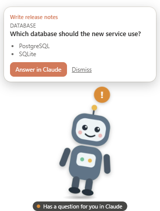
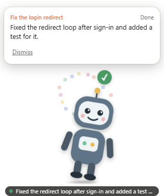
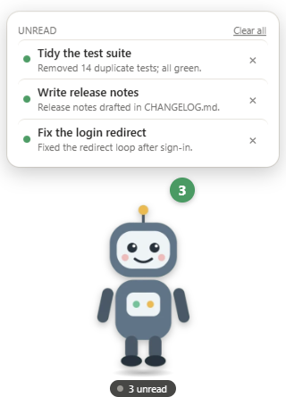
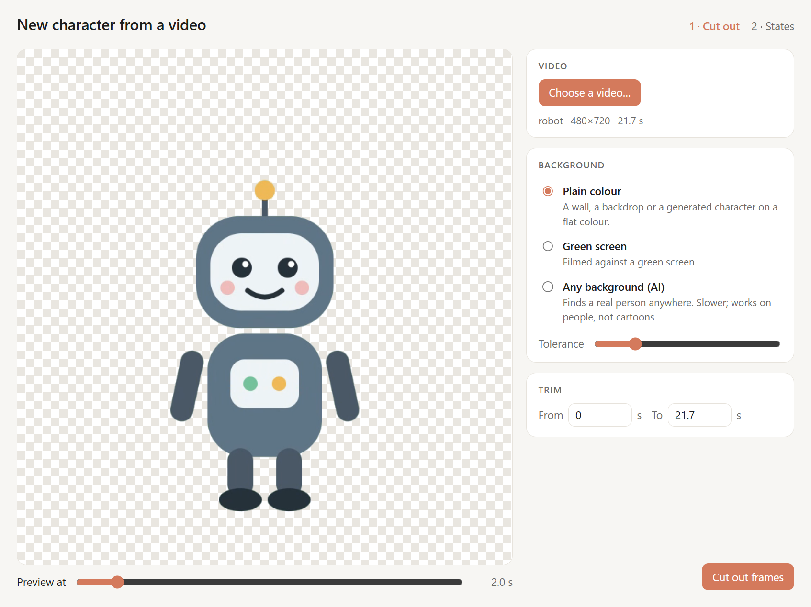
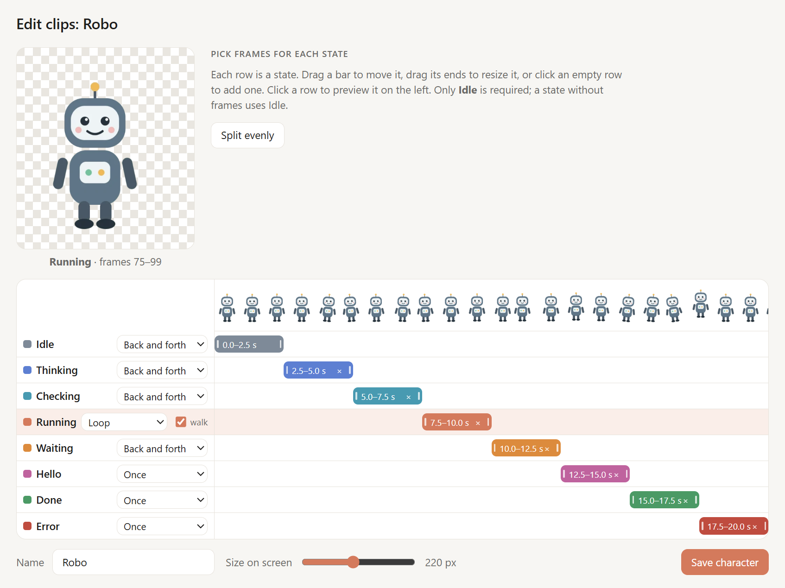
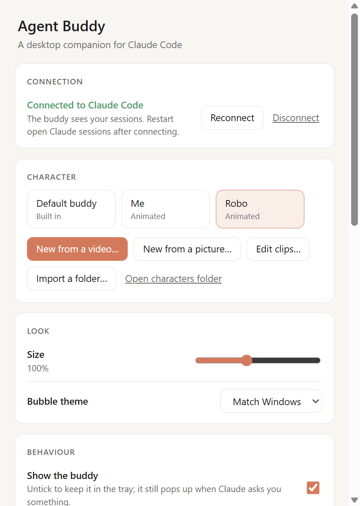

# Agent Buddy

**A desktop companion for Claude Code.** Your own animated character stands on your desktop and shows what
your Claude sessions are doing: thinking, running commands, waiting for you, or done. When a session needs
you, its speech bubble tells you what and takes you straight there.

<p align="center">
  
  
  
</p>

- **Make it yours:** turn one video of yourself (or any character) into an animated buddy. The built-in wizard
  cuts the character out of the background and lets you mark which part of the video plays for each state.
- **Never miss a question:** when Claude asks you something or needs permission, the buddy waves, shows a `!` and
  puts it in a bubble, with an optional chime.
- **Know what finished:** finished sessions stay in an *Unread* list until you open or dismiss them.
- **Stays out of the way:** click-through except for the character and bubble; quiet mode keeps it hidden until a
  session needs you.
- **Local only:** Claude Code talks to it over `127.0.0.1`. Nothing leaves your computer.

Agent Buddy is an independent open-source project. It is not made by or affiliated with Anthropic.

## Install

1. Download **`Agent-Buddy-Setup-<version>.exe`** from the [latest release](https://github.com/m3essam/Agent-Buddy/releases/latest).
2. Run it. It installs for your user only (no admin rights) and starts with Windows. You can turn that off in the tray menu.
   The installer isn't code-signed yet, so Windows SmartScreen may warn the first time: choose **More info → Run anyway**.
3. Settings opens on first run: choose **Connect**. This adds hooks to `~/.claude/settings.json` (a backup is kept) so
   Claude Code can tell the buddy what's happening. Then restart any Claude sessions you already have open.

Installed copies update themselves from GitHub Releases.

Windows only for now. Works with the Claude desktop app (Code tab), and optionally with Claude Code in a terminal or editor.

## Use

| Do this | To |
| --- | --- |
| **Drag** the buddy | Move it anywhere |
| **Click** it | Open the session list: what needs you, what's unread, what's working |
| **Double-click** it | Bring the Claude window forward |
| **Right-click** it (or the tray icon) | Open the menu: character, settings, show/hide, quit |
| Click a session in the list | Open it in Claude |
| **×** on an unread session, or **Clear all** | Dismiss it without opening it |

### Questions and permissions

When Claude asks you a question, it appears **in Claude and in the bubble at the same moment**. You answer once, in
Claude (**Answer in Claude** takes you there), and the bubble clears itself as soon as you do. The Claude desktop app
always shows its own question dialog, so the buddy mirrors it instead of competing with it.

For Claude Code in a terminal or editor, you can also answer questions from the bubble (Settings → *Answering from the
bubble*). You can choose to allow or deny commands and edits from the bubble as well. That is **off by default**: when
it's off, the buddy tells you Claude needs your OK and you answer in Claude.

## Your character

Agent Buddy ships with a placeholder robot. Make your own from **Character** in the menu or in Settings:

### From a video (recommended)

<p align="center">
  
  
</p>

1. Record or generate a short video (5–30 s) of your character doing a few moves one after another: standing,
   thinking, walking, waving, celebrating. A plain background works best.
2. **New character from a video…** → choose the video and how to remove the background:
   - **Plain colour** for a wall, a backdrop or a generated character on a flat colour;
   - **Green screen**;
   - **Any background (AI)**, which finds a real person in an ordinary video using an on-device model.
3. Check the preview, then **Cut out frames**.
4. On the timeline, drag a bar for each state (idle, thinking, checking, running, waiting, hello, done, error) and
   watch the preview. Only *Idle* is required.
5. Name it and **Save character**. Use **Edit clips…** any time to re-time it.

### From a picture

**New character from a picture…** takes one image (a PNG with a transparent background looks best). The buddy gives
it a movement for each state.

### Share one

A character is just a folder in `~/.agent-buddy/characters/`. Zip it and share it; others use
**Import a character folder…**. See [docs/characters.md](docs/characters.md) for tips on recording, the
`character.json` format and the full list of states.

## Settings



Open them from the tray menu or by right-clicking the buddy (**Settings…**). They also open on first run.

- **Connection:** connect or disconnect the Claude Code hooks
- **Character:** pick, create, import or edit a character
- **Look:** size (60–160%) and bubble theme
- **Behaviour:** show or hide the buddy, quiet mode, chime, confetti, how long the "done" bubble stays, reset position
- **Answering from the bubble:** questions (terminal sessions) and permissions (off by default)
- **Sessions:** also follow Claude Code in a terminal or editor
- **System:** start with Windows

Settings are saved in `~/.agent-buddy/config.json`.

<br clear="right">

## How it works

Claude Code's [HTTP hooks](https://code.claude.com/docs/en/hooks) post each session event to
`http://127.0.0.1:47321/hook`. They carry a random token kept in `~/.agent-buddy/token`, plus two headers filled from
Claude Code's environment: which app the session runs in, and the desktop session id (so the buddy can open it).
Status events just update the buddy. For a permission prompt, the buddy can hold the request until you answer in the
bubble; with no answer, Claude asks you as usual. If Agent Buddy isn't running, Claude Code carries on normally.

## Contributing

Ideas, bug reports, characters and pull requests are welcome. [CONTRIBUTING.md](CONTRIBUTING.md) explains how to run
it from source and try changes with the demo script, which plays made-up sessions without Claude.

```
npm install
npm start          # run from source
npm run demo       # play made-up sessions on the running buddy
npm run dist       # build dist/Agent-Buddy-Setup-<version>.exe
```

## License

[MIT](LICENSE). The AI background removal uses Google's MediaPipe selfie segmenter (Apache-2.0).
